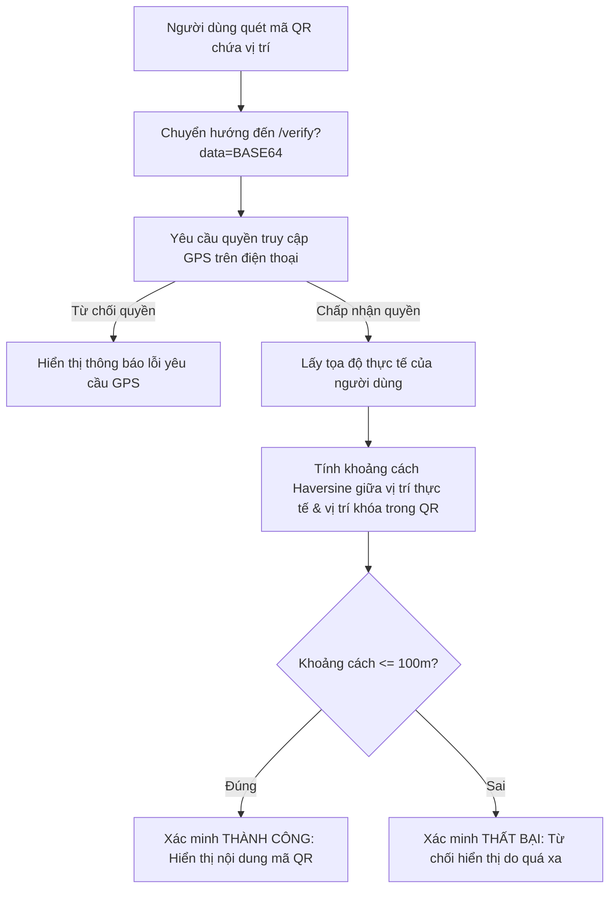

# 🚀 Kaius FastQR - Trình Tạo & Quét Mã QR Chuyên Nghiệp

[](https://nextjs.org/)
[](https://react.dev/)
[](https://www.typescriptlang.org/)
[](https://tailwindcss.com/)
[](https://pnpm.io/)

**Kaius FastQR** là một ứng dụng web hiện đại, chuyên nghiệp, hỗ trợ tạo và quét mã QR trực tuyến một cách nhanh chóng và an toàn. Dự án được tối ưu hóa SEO mạnh mẽ, hỗ trợ song ngữ Anh-Việt, tích hợp các tính năng tùy biến giao diện mã QR nâng cao và đặc biệt là khả năng **Xác thực Vị trí Địa lý (Geo-locking)** độc đáo.

---

## ✨ Các Tính Năng Nổi Bật

### 1. 🎛️ Tạo Mã QR Đa Dạng
Hỗ trợ tạo mã QR cho nhiều loại dữ liệu thông dụng:
*   **Website / URL**: Chuyển hướng đến liên kết web.
*   **Văn bản (Text)**: Hiển thị đoạn văn bản thuần túy.
*   **Email**: Tự động điền email nhận, tiêu đề và nội dung.
*   **Số điện thoại**: Gọi điện trực tiếp.
*   **Danh bạ (vCard)**: Thêm thông tin liên lạc (Tên, SĐT, Email, Địa chỉ, Website...) vào danh bạ điện thoại chỉ bằng một lần quét.
*   **Tin nhắn (SMS)**: Gửi tin nhắn SMS soạn sẵn đến số điện thoại chỉ định.
*   **Sự kiện (Event)**: Lên lịch sự kiện (Tiêu đề, Địa điểm, Thời gian bắt đầu/kết thúc, Mô tả).
*   **Wi-Fi**: Kết nối nhanh Wi-Fi (SSID, Mật khẩu, Loại bảo mật WPA/WEP, ẩn SSID).
*   **Vị trí**: Lưu trữ tọa độ bản đồ.
*   **Facebook**: Liên kết trực tiếp đến trang cá nhân hoặc fanpage.
*   **Multi-Link**: Tạo một trang trung gian chứa danh sách nhiều liên kết (giống Linktree) để hiển thị đồng thời nhiều nội dung.

### 2. 🎨 Tùy Biến Thẩm Mỹ Cao Cấp
*   **Bảng màu phong phú**: Chọn từ các mẫu màu (Preset) có sẵn hoặc tự định nghĩa màu sắc tùy ý cho phần họa tiết (Foreground) và màu nền (Background).
*   **Kiểm tra độ tương phản tự động**: Tích hợp thuật toán tính tỷ lệ tương phản để cảnh báo nếu màu sắc được chọn quá mờ nhạt, giúp đảm bảo máy quét luôn đọc được mã QR.
*   **Kiểu dáng đa dạng**:
    *   *Kiểu điểm ảnh (Dot Styles)*: Vuông (Square), Bo góc (Rounded), Tròn (Circle), Kim cương (Diamond).
    *   *Kiểu góc (Corner Styles)*: Vuông (Square), Bo góc (Rounded), Tròn (Circle).
*   **Tích hợp Logo**:
    *   Tải lên logo cá nhân hoặc doanh nghiệp tùy chọn.
    *   Tùy chỉnh kích thước logo (thu nhỏ/phóng to theo tỷ lệ an toàn của QR code để tránh lỗi quét).
    *   Bật/tắt viền bo tròn cho logo để đồng bộ thẩm mỹ.

### 3. 📍 Xác Thực Vị Trí Địa Lý (Geo-Locked QR)
Đây là tính năng độc đáo nhất của **Kaius FastQR**:
*   Khi tạo mã QR, người dùng có thể kích hoạt tùy chọn **"Yêu cầu vị trí"** và nhập tọa độ GPS mục tiêu.
*   Khi quét mã QR này, người dùng sẽ được chuyển hướng đến cổng xác thực `/verify`.
*   Cổng xác thực sẽ yêu cầu quyền truy cập GPS của thiết bị quét và tính toán khoảng cách (theo công thức Haversine) giữa vị trí thực tế của thiết bị và vị trí được khóa trong mã QR.
*   Nếu thiết bị nằm trong bán kính **100 mét** cho phép, nội dung thực sự của mã QR mới được hiển thị. Nếu không, hệ thống sẽ từ chối truy cập. Tính năng này vô cùng hữu ích cho hoạt động chấm công, điểm danh sự kiện tại chỗ, hoặc trò chơi giải đố săn tìm kho báu địa lý.

### 4. 📷 Máy Quét QR Tích Hợp
*   **Quét qua Camera**: Sử dụng luồng webcam thời gian thực trực tiếp trên trình duyệt bằng thư viện `jsQR`.
*   **Tải lên hình ảnh**: Đọc và giải mã mã QR trực tiếp từ tệp hình ảnh được tải lên từ thiết bị.

---

## 🛠️ Công Nghệ Sử Dụng

| Thành phần | Công nghệ / Thư viện | Vai trò |
| :--- | :--- | :--- |
| **Framework** | Next.js 14 (App Router) | Xây dựng cấu trúc ứng dụng và định tuyến SSR/Client |
| **Giao diện (UI)** | React 18, Tailwind CSS | Phát triển component và thiết kế responsive |
| **Component Thư viện** | Radix UI, Lucide React | Các component nền tảng (Tabs, Dialog, Slider, Dropdown...) và Icon |
| **Thư viện QR Core** | `qrcode`, `jsqr` | Tạo và giải mã dữ liệu mã QR |
| **Quản lý form** | React Hook Form & Zod | Validate dữ liệu nhập vào form |
| **Kiểm tra tương phản** | Thuật toán contrast-ratio tùy biến | Đảm bảo mã QR luôn đủ độ tương phản để quét |
| **Bản địa hóa** | Context-based Language Provider | Hỗ trợ đa ngôn ngữ (EN/VI) linh hoạt |

---

## 📂 Cấu Trúc Thư Mục Dự Án

```text
KaiusFastQR/
├── app/                  # Thư mục chứa các page của Next.js (App Router)
│   ├── links/            # Trang đích hiển thị Multi-Link
│   ├── verify/           # Trang cổng xác thực vị trí (Geo-verification)
│   ├── globals.css       # File cấu hình CSS toàn cục & biến Tailwind
│   ├── layout.tsx        # Bố cục giao diện tổng thể (cài đặt SEO, font...)
│   └── page.tsx          # Trang chủ chính (chứa QRGeneratorClient)
├── components/           # Các component tái sử dụng
│   ├── ui/               # Các component UI cơ bản (Button, Card, Input, Slider...)
│   ├── header.tsx        # Thanh điều hướng phía trên
│   ├── language-provider.tsx # Context quản lý ngôn ngữ & bộ dịch
│   ├── theme-provider.tsx    # Quản lý giao diện sáng/tối (Dark Mode)
│   └── QRGeneratorClient.tsx # Component chính chứa toàn bộ logic tạo/quét/tùy biến QR
├── lib/                  # Cấu hình hệ thống và tiện ích dùng chung
│   ├── site-config.ts    # Cấu hình SEO mặc định, domain và sitemap
│   └── utils.ts          # Hàm tiện ích Tailwind merge
├── utils/                # Các hàm xử lý thuật toán
│   ├── base64.ts         # Mã hóa & giải mã dữ liệu Base64 an toàn cho URL
│   └── color-validation.ts # Tính toán độ tương phản giữa foreground & background
├── public/               # Tài nguyên tĩnh (Hình ảnh, logo, favicon...)
├── translate_vi.py       # Script tự động dịch các key tiếng Anh sang tiếng Việt trong code
├── cgi.py                # Shim tương thích cho module cgi của python trên các môi trường mới
├── package.json          # Quản lý script và các thư viện phụ thuộc
└── tsconfig.json         # Cấu hình TypeScript cho dự án
```

---

## ⚙️ Hướng Dẫn Cài Đặt & Chạy Thử

Dự án yêu cầu cài đặt **Node.js (phiên bản từ 20 đến dưới 21)** và trình quản lý gói **pnpm**.

### 1. Khởi chạy môi trường phát triển
Tải mã nguồn về máy, mở thư mục dự án và thực hiện các lệnh sau:

```bash
# Cài đặt các thư viện phụ thuộc
pnpm install

# Khởi chạy server local cho môi trường dev
pnpm run dev
```

Sau khi chạy lệnh trên, ứng dụng sẽ hoạt động tại địa chỉ: [http://localhost:3000](http://localhost:3000).

### 2. Các script hữu ích khác
*   `pnpm run build`: Tạo bản build tối ưu cho môi trường production.
*   `pnpm run start`: Khởi chạy production server (sau khi build).
*   `pnpm run clean`: Xóa thư mục cache `.next` để làm sạch bộ nhớ tạm.
*   `pnpm run dev:clean`: Làm sạch cache và khởi chạy môi trường dev.
*   `pnpm run lint`: Chạy trình kiểm tra lỗi cú pháp và định dạng code ESLint.

---

## 🔒 Cơ Chế Xác Thực Vị Trí Hoạt Động Như Thế Nào?



### 🌍 Công thức tính khoảng cách Haversine được sử dụng:
Công thức Haversine được lập trình trực tiếp trong mã nguồn giúp tính khoảng cách đường cong giữa hai điểm trên bề mặt Trái Đất dựa vào kinh độ (longitude) và vĩ độ (latitude):

```typescript
function calculateDistance(lat1: number, lon1: number, lat2: number, lon2: number): number {
  const R = 6371e3; // Bán kính Trái Đất tính bằng mét
  const φ1 = (lat1 * Math.PI) / 180;
  const φ2 = (lat2 * Math.PI) / 180;
  const Δφ = ((lat2 - lat1) * Math.PI) / 180;
  const Δλ = ((lon2 - lon1) * Math.PI) / 180;

  const a = Math.sin(Δφ / 2) * Math.sin(Δφ / 2) +
            Math.cos(φ1) * Math.cos(φ2) *
            Math.sin(Δλ / 2) * Math.sin(Δλ / 2);
  const c = 2 * Math.atan2(Math.sqrt(a), Math.sqrt(1 - a));

  return R * c; // Kết quả tính bằng mét
}
```

---

## 🌐 Tự Động Bản Địa Hóa (Localization Script)

Dự án cung cấp một script Python `translate_vi.py` để dịch tự động các nội dung tiếng Anh sang tiếng Việt trong tệp định nghĩa đa ngôn ngữ [language-provider.tsx](file:///t:/Kaius_Inc/KaiusFastQR/components/language-provider.tsx).

Để chạy script dịch (yêu cầu cài đặt python và thư viện `googletrans`):
```bash
pip install googletrans==4.0.0-rc1
python translate_vi.py
```
Script sẽ tự động đọc phần ngôn ngữ `en`, thực hiện dịch qua Google Translate API (có bảo vệ các placeholder `{param}` trong văn bản) và cập nhật lại phần ngôn ngữ `vi` tương ứng một cách chính xác.

---

## 🎨 Trải Nghiệm Thiết Kế Tối Ưu (UX/UI & SEO)
*   **Giao diện Tối/Sáng linh hoạt**: Đồng bộ với hệ điều hành thông qua thư viện `next-themes`.
*   **SEO Chuẩn Chỉ**: Có sẵn tệp [sitemap.ts](file:///t:/Kaius_Inc/KaiusFastQR/app/sitemap.ts) và [robots.ts](file:///t:/Kaius_Inc/KaiusFastQR/app/robots.ts) tự động tạo nội dung lập chỉ mục cho các công cụ tìm kiếm Google/Bing.
*   **Hiệu suất tải trang cao**: Import động component quét QR nặng bằng `dynamic(..., { ssr: false })` giúp giảm dung lượng tải trang đầu tiên (initial JS bundle).

---

## 📄 Giấy Phép
Dự án được phát hành mã nguồn mở dưới giấy phép **MIT License**. Bạn có thể tự do học tập, sử dụng và tùy biến.

---
*Phát triển bởi Nguyễn Công Thức (Kaius).*
