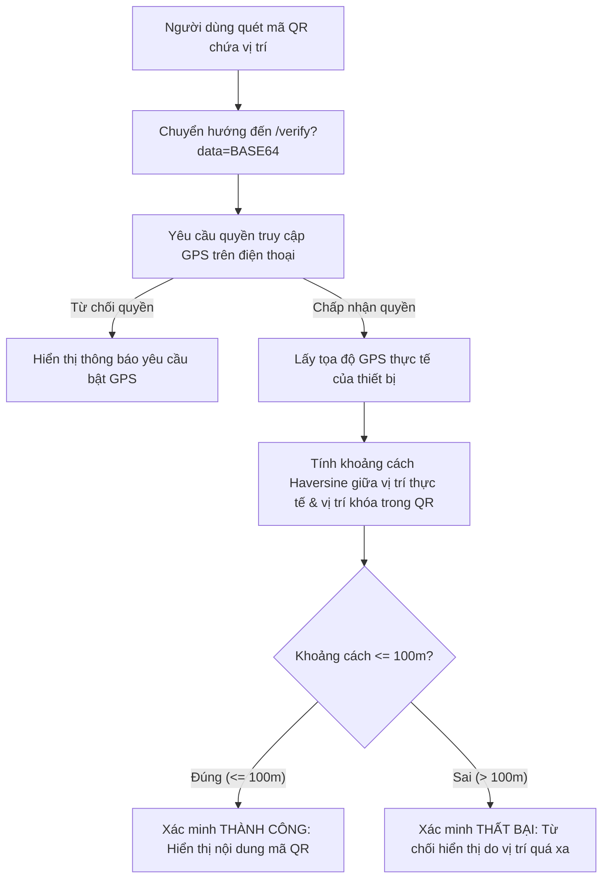

# 🚀 Kaius FastQR - Trình Tạo & Quét Mã QR Chuyên Nghiệp

[](https://nextjs.org/)
[](https://react.dev/)
[](https://www.typescriptlang.org/)
[](https://tailwindcss.com/)
[](https://pnpm.io/)
[](https://opensource.org/licenses/MIT)

**Kaius FastQR** là một ứng dụng web hiện đại, chuyên nghiệp, hỗ trợ tạo và quét mã QR trực tuyến một cách nhanh chóng và an toàn. Dự án được tối ưu hóa SEO mạnh mẽ, hỗ trợ song ngữ Anh - Việt, tích hợp các tính năng tùy biến giao diện mã QR nâng cao và đặc biệt là khả năng **Xác thực Vị trí Địa lý (Geo-locking)** độc đáo.

---

## ✨ Các Tính Năng Nổi Bật

### 1. 🎛️ Tạo Mã QR Đa Dạng
Hỗ trợ tạo mã QR cho nhiều loại dữ liệu thông dụng:
*   **Website / URL**: Chuyển hướng đến liên kết web.
*   **Văn bản (Text)**: Hiển thị đoạn văn bản thuần túy.
*   **Email**: Tự động điền email người nhận, tiêu đề và nội dung.
*   **Số điện thoại**: Gọi điện trực tiếp.
*   **Danh bạ (vCard)**: Thêm thông tin liên lạc (Tên, SĐT, Email, Địa chỉ, Website...) vào danh bạ điện thoại chỉ bằng một lần quét.
*   **Tin nhắn (SMS)**: Gửi tin nhắn SMS soạn sẵn đến số điện thoại chỉ định.
*   **Sự kiện (Event)**: Lên lịch sự kiện (Tiêu đề, Địa điểm, Thời gian bắt đầu/kết thúc, Mô tả).
*   **Wi-Fi**: Kết nối nhanh Wi-Fi (SSID, Mật khẩu, Loại bảo mật WPA/WEP, Ẩn SSID).
*   **Vị trí**: Lưu trữ tọa độ bản đồ (Latitude & Longitude).
*   **Facebook**: Liên kết trực tiếp đến trang cá nhân hoặc fanpage.
*   **Multi-Link (MultiURL)**: Tạo một trang trung gian chứa danh sách nhiều liên kết (giống Linktree) để hiển thị đồng thời nhiều nội dung.

### 2. 🎨 Tùy Biến Thẩm Mỹ Cao Cấp
*   **Bảng màu phong phú & Presets**: Chọn từ các mẫu màu sắc có sẵn (Default, Brand, Midnight, Emerald, Sunset, Neon, Pastel) hoặc tự định nghĩa màu sắc tùy ý cho phần họa tiết (Foreground) và màu nền (Background).
*   **Kiểm tra độ tương phản tự động (WCAG Contrast Ratio)**: Tích hợp thuật toán tính tỷ lệ tương phản màu sắc để cảnh báo nếu màu chọn quá mờ nhạt, đảm bảo máy quét luôn đọc được mã QR.
*   **Kiểu dáng đa dạng**:
    *   *Kiểu điểm ảnh (Dot Styles)*: Vuông (Square), Bo góc (Rounded), Tròn (Circle), Kim cương (Diamond).
    *   *Kiểu góc (Corner Styles)*: Vuông (Square), Bo góc (Rounded), Tròn (Circle).
*   **Tích hợp Logo cá nhân / doanh nghiệp**:
    *   Tải lên logo cá nhân tùy chọn.
    *   Tùy chỉnh kích thước logo (phóng to / thu nhỏ trong tỷ lệ an toàn của mã QR để tránh làm hỏng mã quét).
    *   Bật / tắt viền bo tròn cho logo để đồng bộ thẩm mỹ.

### 3. 📍 Xác Thực Vị Trí Địa Lý (Geo-Locked QR)
Đây là tính năng độc đáo của **Kaius FastQR**:
*   Khi tạo mã QR, người dùng có thể kích hoạt tùy chọn **"Yêu cầu vị trí"** và nhập tọa độ GPS mục tiêu.
*   Khi quét mã QR này, người dùng sẽ được chuyển hướng đến cổng xác thực vị trí [`/verify`](app/verify/page.tsx).
*   Cổng xác thực sẽ yêu cầu quyền truy cập GPS của thiết bị quét và tính toán khoảng cách (theo công thức Haversine) giữa vị trí thực tế của thiết bị và vị trí được khóa trong mã QR.
*   Nếu thiết bị nằm trong bán kính **100 mét** cho phép, nội dung thực sự của mã QR mới được hiển thị. Tính năng này hữu ích cho hoạt động chấm công, điểm danh sự kiện tại chỗ, hoặc trò chơi giải đố săn tìm kho báu địa lý.

### 4. 📷 Máy Quét QR Tích Hợp
*   **Quét qua Camera**: Sử dụng webcam / camera thiết bị thời gian thực trực tiếp trên trình duyệt bằng thư viện `jsQR`.
*   **Tải lên hình ảnh**: Đọc và giải mã mã QR trực tiếp từ tệp hình ảnh được tải lên từ thiết bị.

---

## 🛠️ Công Nghệ Sử Dụng

| Thành phần | Công nghệ / Thư viện | Vai trò |
| :--- | :--- | :--- |
| **Framework** | Next.js 14.2.24 (App Router) | Xây dựng cấu trúc ứng dụng và định tuyến SSR/Client |
| **Giao diện (UI)** | React 18, Tailwind CSS 3.4.17 | Phát triển component và thiết kế giao diện responsive |
| **Component Thư viện** | Radix UI, Lucide React | Các component nền tảng (Tabs, Dialog, Slider, Dropdown...) và hệ thống Icon |
| **Thư viện QR Core** | `qrcode`, `jsqr` | Tạo và giải mã dữ liệu mã QR |
| **Quản lý Form** | React Hook Form & Zod | Validate dữ liệu nhập vào form chính xác |
| **Kiểm tra tương phản** | Thuật toán contrast-ratio tùy biến | Cảnh báo độ tương phản foreground & background |
| **Bản địa hóa** | Context-based Language Provider | Hỗ trợ đa ngôn ngữ (EN/VI) linh hoạt |
| **Quản lý Giao diện** | `next-themes` | Hỗ trợ chuyển đổi chế độ Sáng / Tối (Dark / Light mode) |

---

## 📂 Cấu Trúc Thư Mục Dự Án

```text
KaiusFastQR/
├── app/                      # Thư mục chứa các route & page Next.js (App Router)
│   ├── links/                # Route hiển thị trang tổng hợp Multi-Link
│   │   └── page.tsx
│   ├── verify/               # Route cổng xác thực vị trí (Geo-verification)
│   │   ├── loading.tsx
│   │   └── page.tsx
│   ├── globals.css           # Cấu hình CSS toàn cục & biến giao diện Tailwind
│   ├── layout.tsx            # Root Layout (cài đặt SEO, font, Theme & Language provider)
│   ├── page.tsx              # Trang chủ ứng dụng (chứa QRGeneratorClient)
│   ├── robots.ts             # Tự động tạo tệp robots.txt chuẩn SEO
│   └── sitemap.ts            # Tự động tạo sitemap.xml động
├── components/               # Các component React tái sử dụng
│   ├── ui/                   # Các component UI cơ bản (Button, Card, Input, Slider, Dialog...)
│   ├── header.tsx            # Thanh điều hướng (Header navigation)
│   ├── language-provider.tsx # Context quản lý ngôn ngữ (EN/VI) & từ điển dịch
│   ├── theme-provider.tsx    # Provider quản lý giao diện sáng/tối (Dark Mode)
│   └── QRGeneratorClient.tsx # Component chính chứa toàn bộ logic tạo/quét/tùy biến QR
├── hooks/                    # Custom React Hooks
│   ├── use-mobile.tsx        # Hook phát hiện thiết bị di động
│   └── use-toast.ts          # Hook hiển thị thông báo Toast Notification
├── lib/                      # Cấu hình hệ thống và tiện ích dùng chung
│   ├── site-config.ts        # Cấu hình SEO mặc định, domain và sitemap URL
│   └── utils.ts              # Hàm tiện ích gộp class Tailwind (clsx & tailwind-merge)
├── utils/                    # Thuật toán xử lý chuyên dụng
│   ├── base64.ts             # Mã hóa & giải mã Base64 an toàn cho URL (hỗ trợ UTF-8)
│   └── color-validation.ts   # Thuật toán tính độ tương phản & khoảng cách màu sắc
├── public/                   # Tài nguyên tĩnh (Hình ảnh, logo, og-image, favicon, manifest...)
├── translate_vi.py           # Script Python tự động dịch các key từ điển EN -> VI
├── cgi.py                    # Shim tương thích cho module cgi của Python 3.13+
├── SEO_CHECKLIST.md          # Tài liệu đánh giá và kiểm tra chỉ số SEO của dự án
├── package.json              # Quản lý script và danh sách thư viện phụ thuộc
└── tsconfig.json             # Cấu hình TypeScript cho dự án
```

---

## ⚙️ Hướng Dẫn Cài Đặt & Chạy Thử

### Yêu cầu môi trường:
*   **Node.js**: Phiên bản `>= 20.0.0`
*   **pnpm**: Phiên bản `>= 10.0.0` (Khuyên dùng) hoặc `npm` / `yarn`

### 1. Khởi chạy môi trường phát triển (Development)
Tải mã nguồn về máy, mở thư mục dự án và thực hiện các lệnh sau:

```bash
# Cài đặt các thư viện phụ thuộc
pnpm install

# Khởi chạy server local cho môi trường dev
pnpm run dev
```

Sau khi khởi chạy thành công, ứng dụng sẽ hoạt động tại: **[http://localhost:3000](http://localhost:3000)**.

### 2. Danh sách các lệnh script có sẵn

| Lệnh | Công dụng |
| :--- | :--- |
| `pnpm run dev` | Khởi chạy môi trường phát triển (Development mode). |
| `pnpm run dev:clean` | Xóa bộ nhớ tạm `.next` và khởi chạy dev server. |
| `pnpm run dev:nocache` | Làm sạch cache và khởi chạy dev server tắt Webpack cache. |
| `pnpm run build` | Biên dịch dự án và tạo bản build tối ưu cho sản xuất. |
| `pnpm run build:clean` | Xóa bộ nhớ tạm `.next` và tiến hành build sản xuất. |
| `pnpm run start` | Khởi chạy Production Server (sau khi đã chạy `pnpm run build`). |
| `pnpm run clean` | Xóa thư mục cache `.next` để làm sạch bộ nhớ tạm. |
| `pnpm run lint` | Chạy kiểm tra lỗi cú pháp và định dạng code ESLint. |

---

## 🔒 Cơ Chế Xác Thực Vị Trí Hoạt Động Như Thế Nào?

Quy trình xác thực vị trí khi quét mã QR Geo-Locked:



### 🌍 Thuật toán tính khoảng cách Haversine:
Công thức Haversine được cài đặt trực tiếp tại [`app/verify/page.tsx`](app/verify/page.tsx) giúp tính toán khoảng cách đường cong mặt cầu giữa hai điểm tọa độ GPS:

```typescript
function calculateDistance(lat1: number, lon1: number, lat2: number, lon2: number): number {
  const R = 6371e3 // Bán kính Trái Đất tính bằng mét
  const φ1 = (lat1 * Math.PI) / 180
  const φ2 = (lat2 * Math.PI) / 180
  const Δφ = ((lat2 - lat1) * Math.PI) / 180
  const Δλ = ((lon2 - lon1) * Math.PI) / 180

  const a = Math.sin(Δφ / 2) * Math.sin(Δφ / 2) + 
            Math.cos(φ1) * Math.cos(φ2) * 
            Math.sin(Δλ / 2) * Math.sin(Δλ / 2)
  const c = 2 * Math.atan2(Math.sqrt(a), Math.sqrt(1 - a))

  return R * c // Kết quả trả về tính bằng mét
}
```

---

## 🌐 Script Tự Động Dịch Ngôn Ngữ (Localization Tool)

Dự án cung cấp một script Python [`translate_vi.py`](translate_vi.py) để tự động đồng bộ và dịch các từ điển tiếng Anh (`en`) sang tiếng Việt (`vi`) trong tệp quản lý ngôn ngữ [`components/language-provider.tsx`](components/language-provider.tsx).

Đồng thời, tệp [`cgi.py`](cgi.py) đóng vai trò là thư viện shim tương thích giúp script hoạt động ổn định trên các phiên bản **Python 3.13+** (nơi module `cgi` của thư viện chuẩn đã bị loại bỏ).

Cách sử dụng script dịch:
```bash
# Cài đặt thư viện googletrans phiên bản thích hợp
pip install googletrans==4.0.0-rc1

# Khởi chạy script dịch
python translate_vi.py
```
Script sẽ đọc phần dữ liệu `en`, bảo vệ các tham số dạng `{param}`, thực hiện dịch qua Google Translate API và cập nhật lại phần ngôn ngữ `vi` trong code.

---

## 🎨 Trải Nghiệm Thiết Kế Tối Ưu (UX/UI & SEO)

*   **Giao diện Tối/Sáng linh hoạt**: Đồng bộ với hệ điều hành thông qua thư viện `next-themes`.
*   **SEO Chuẩn Chỉ**: Tự động tạo tệp [`sitemap.ts`](app/sitemap.ts) và [`robots.ts`](app/robots.ts) hỗ trợ lập chỉ mục tối ưu trên Google / Bing.
*   **Tối ưu hiệu suất tải trang**: Import động component quét QR nặng bằng `dynamic(..., { ssr: false })` giúp giảm dung lượng tải trang ban đầu (Initial JS Bundle).

---

## 📄 Giấy Phép
Dự án được phát hành mã nguồn mở dưới giấy phép **[MIT License](LICENSE)**. Bạn có thể tự do sử dụng, học tập và tùy biến.

---
*Phát triển bởi Nguyễn Công Thức (Kaius).*
